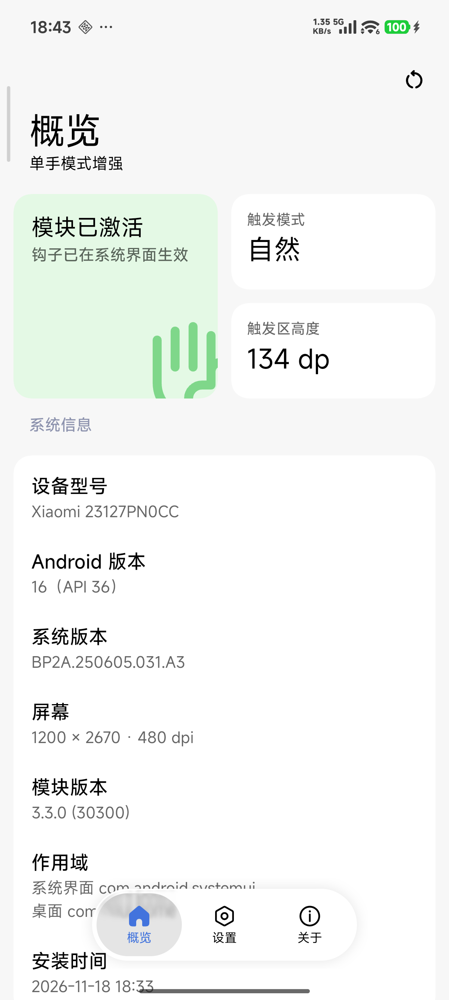
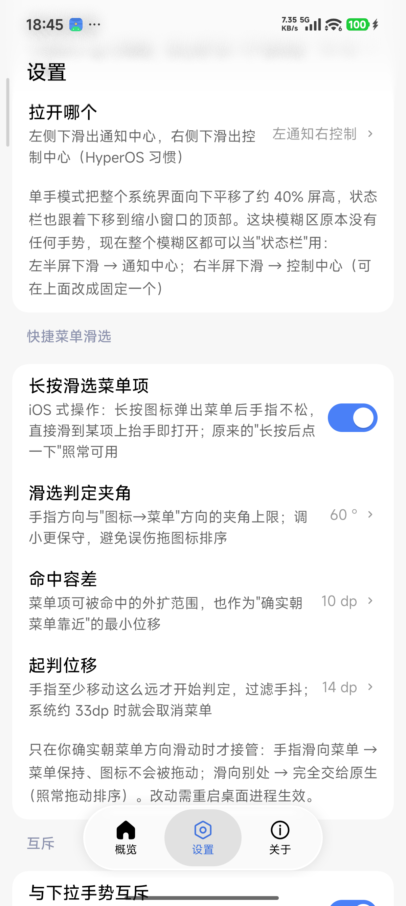
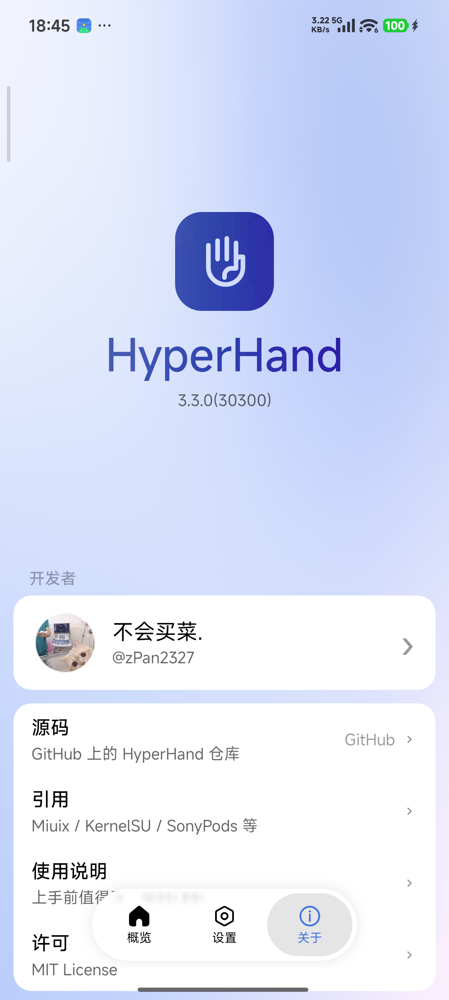
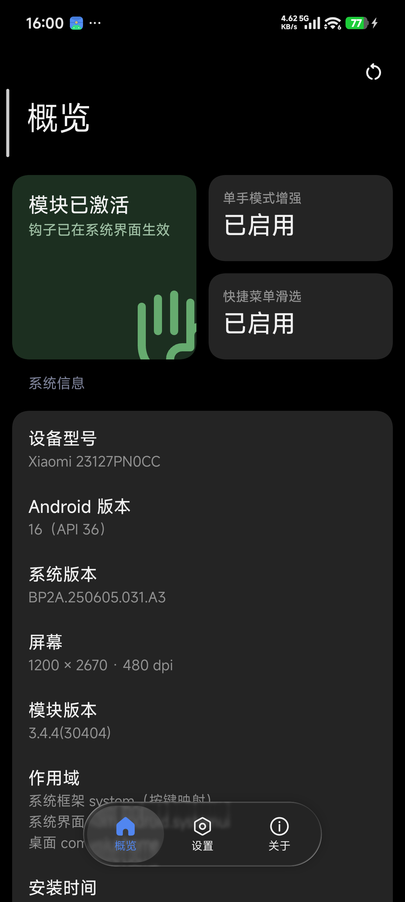

# HyperHand — 把 iPhone 的手感搬进 HyperOS

给 **小米 14 / HyperOS 3（Android 16）** 用的系统增强模块。不改系统文件、不替换 APK，
OTA 不受影响，停用就恢复原样。

## 它解决什么问题？

### 问题一：快捷菜单得「松手再点」，两步太麻烦

HyperOS 长按桌面图标弹出菜单后，必须先**松手、再点一下**菜单项；手指一滑，图标就被拖着跑，
菜单还会被系统当成「拖过阈值」直接关掉。

**装上后**：长按图标，手指别松，直接滑到要的那项，抬手就打开。菜单在图标上方或下方都行，
图标不会乱动，滑过的项有浅灰按压 + 震动反馈。

### 问题二：单手模式太难触发

HyperOS 的单手模式要在屏幕最底部一条 **25dp 窄条**上下滑，手稍微高一点就没反应，而且没法调。

**装上后**：触发区扩大到 134dp（可调），覆盖整个 dock；按下落点判定，不跟桌面下拉抢手势。
动画快慢、模糊壁纸背景、下滑开通知/控制中心也都能调。

## 截图

浅色（默认）：

| 概览 | 快捷菜单滑选 | 关于 |
|---|---|---|
|  |  |  |

深色模式

| 概览 | 快捷菜单滑选 | 关于 |
|---|---|---|
|  |  |  |

## 安装

从 [Releases](../../releases) 下载 `HyperHand.apk`，在 Vector / LSPosed 中启用即可。

- 作用域：`com.android.systemui`、`com.miui.home`
- 需要 libxposed API 102（Vector 2.x / 新版 LSPosed）
- 设置页可调触发区、动画、模糊背景，以及滑选开关、角度和容差

## 源码

https://github.com/zPan2327/HyperHand

## License

MIT
