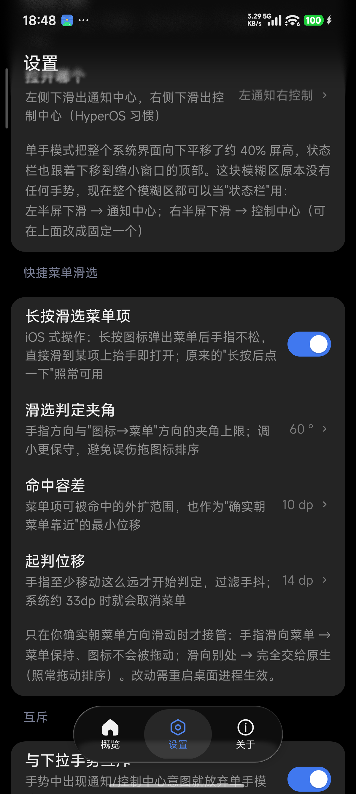
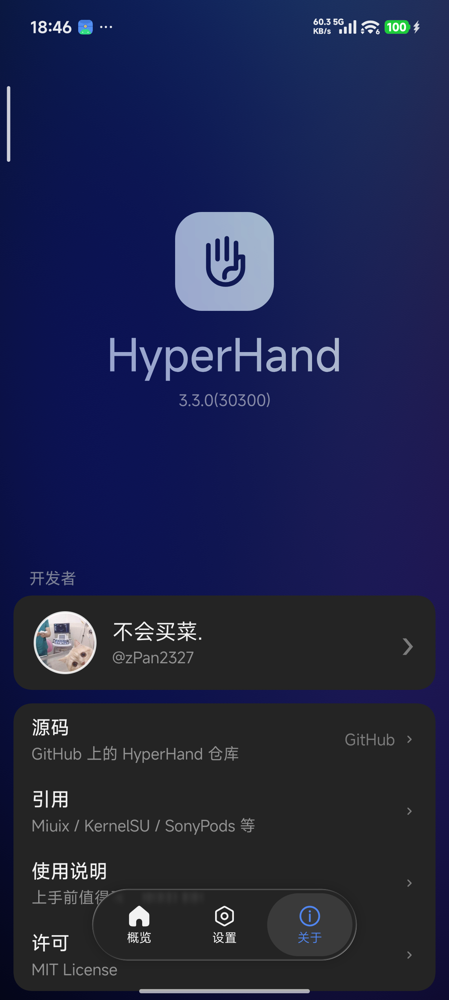

# HyperHand

HyperOS 系统增强模块，提供三组功能：音量键映射、底部下滑单手模式、桌面快捷菜单滑选。
只改触发与交互层，系统原有的动画、布局、窗口行为保持不变。适配小米 14 / HyperOS 3（Android 16）。

## 功能

### 智能按键映射

把音量上/下键的短按、长按、双击、连按分别映射到下一首、上一首、播放暂停、音量等动作。
一条规则由触发方式、状态条件（前台应用、播放状态、锁屏、屏幕方向）、动作三部分组成，
多个条件可按「全部满足 / 任一满足」组合；规则之间按优先级匹配，四种按压方式分别找规则。
四种动作都设为「保持原功能」时整条事件透传，系统音量照常响应。

需要勾选 `system` 作用域。跨进程配置通过 `Settings.Global` 传递，首次使用会请求
`WRITE_SECURE_SETTINGS` 授权（需 root 执行一次 `pm grant`）。应用列表存磁盘快照并后台刷新，
图标懒加载，选择时可把已选应用置顶并标注推荐应用。

### 单手模式增强

系统入口是屏幕最底部 25dp 的窄条。模块把触发区放大（默认 56dp，可调），支持宽度裁切与左右偏置，
提供自然 / 灵敏 / 防误触三档识别，处理与下拉通知、控制中心的手势冲突。
缩小动画时长与曲线、模糊壁纸背景、模糊区下滑拉面板都可以单独调。
调用的是系统自己的 `OneHandedController.startOneHanded()`，退出方式与原生一致。

### 桌面快捷菜单滑选

长按桌面图标弹出菜单后手指不松开，直接滑到目标项抬手选中；菜单在上方或下方都可用，
图标不会跟着移动。命中项是浅灰按压态加系统同款震动。

## 截图

浅色（默认）：

| 概览 | 快捷菜单滑选 | 关于 |
|---|---|---|
|  |  |  |

深色模式

| 概览 | 快捷菜单滑选 | 关于 |
|---|---|---|
|  |  |  |

## 安装

从 [Releases](../../releases) 下载 `HyperHand.apk` 安装，在 Vector / 新版 LSPosed 中启用模块。

作用域勾选：

- `system`（system_server）：智能按键映射必需
- `com.android.systemui`：单手模式、状态栏手势
- `com.miui.home`：桌面图标快捷菜单、单手模式

需要支持 libxposed API 102 的框架（Vector / 新版 LSPosed），以及 Android 16 / HyperOS 3。
不修改系统文件、不替换 APK，OTA 不受影响，停用模块即恢复原状。

> 本模块**只在小米 14（houji / Android 16 / HyperOS 3）上实测过**。其他小米 / 红米系机型
> 理论上都可以使用，但不同机型的系统类名或方法名可能不同，钩子会静默失效（不会崩溃），
> 请自行测试。

## 3.4.3 修复

在控制中心 / 通知中心里从屏幕下方起手往右滑切换时，手指落点常落在单手模式触发区内。
此前会被误判为下拉手势，拦掉系统的展开调用，导致切换动画卡住后整个面板被收起。
现在只在确实向下拖时才让单手模式拦截，横向切换正常放行。

## 源码与文档

https://github.com/zPan2327/HyperHand

详细的实现原理、真机验证报告与常见问题见源码仓库的 `docs/` 目录。
完整更新记录见源码仓库的 `CHANGELOG.md`。

## License

MIT

如果这个项目对你有用，欢迎点个 **Star** ⭐，这是继续维护的最大动力。
